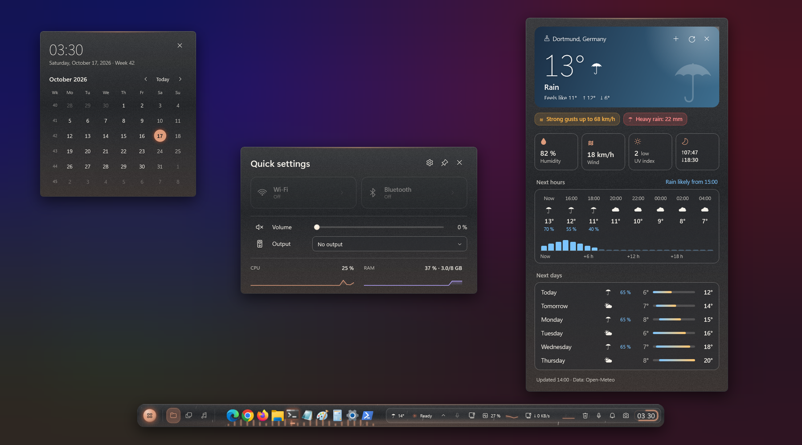
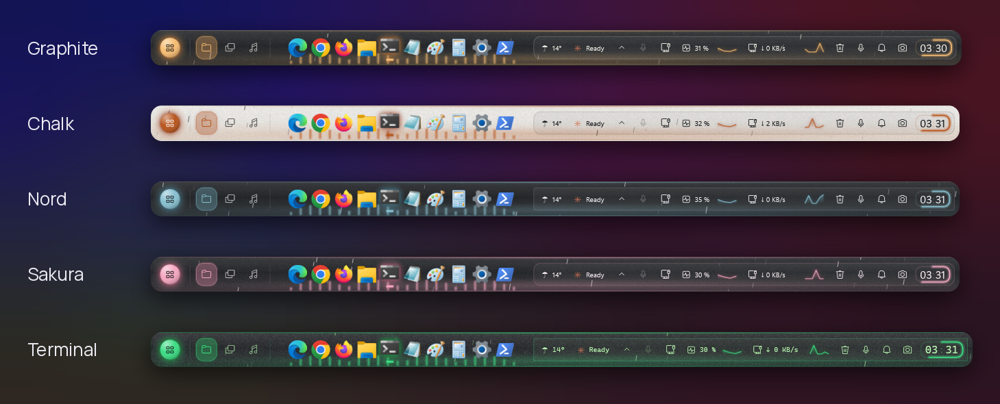
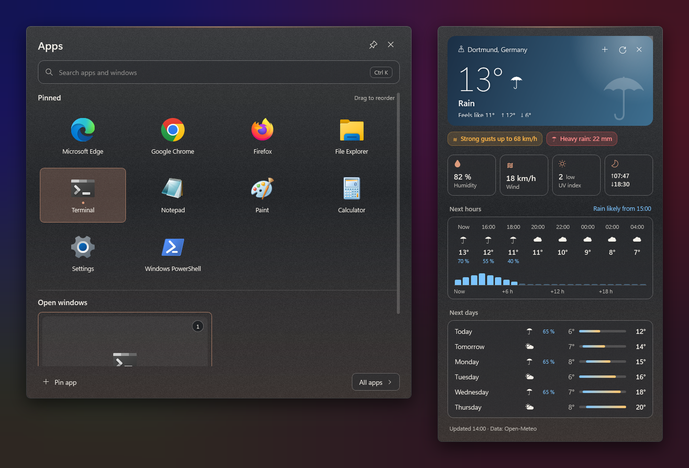
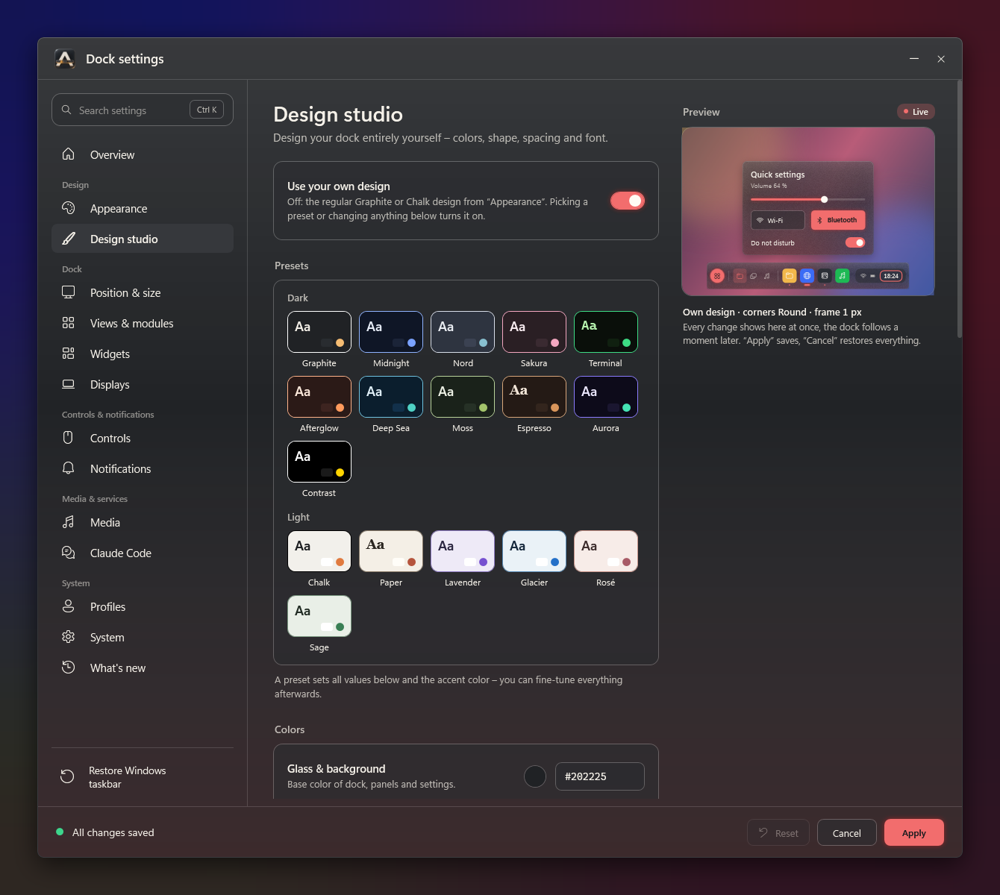
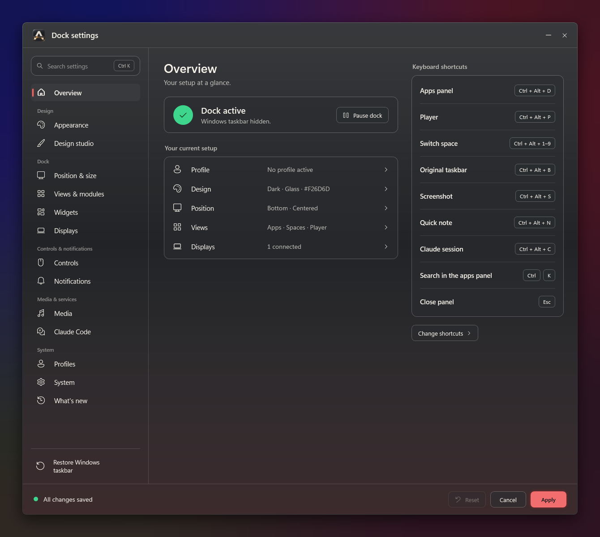
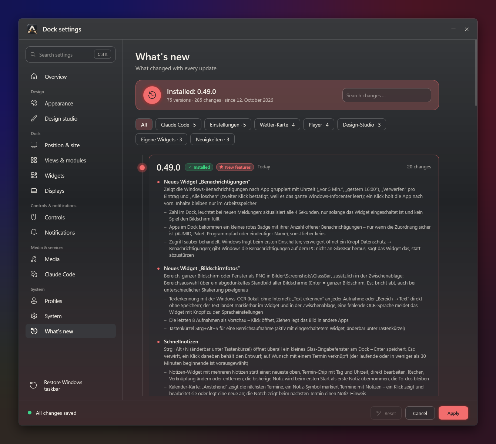
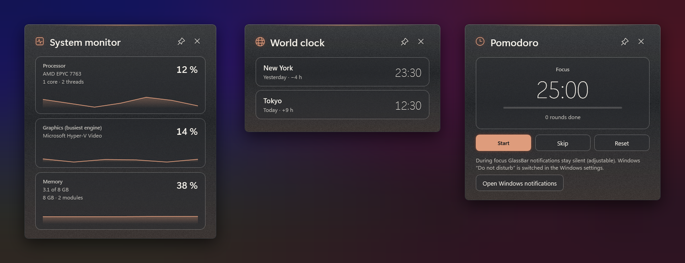
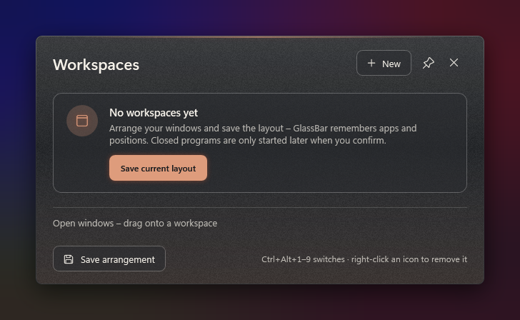
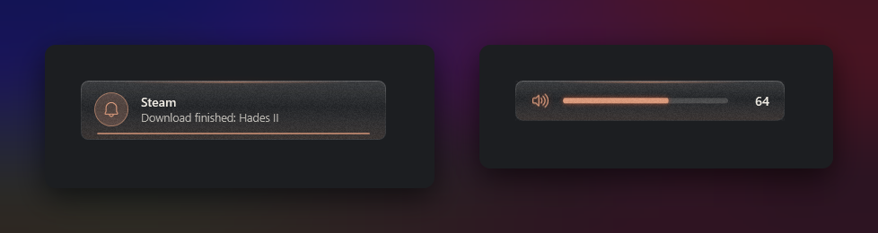

# GlassBar

**A floating glass dock that replaces the Windows 11 taskbar.**
Apps, music, weather, calendar, widgets and Claude Code in one bar whose accent color follows the album cover that is playing.

**English** · [Deutsch](docs/README.de.md)

---

## What is GlassBar?

GlassBar hides the Windows taskbar and puts a floating dock made of real acrylic glass in its place. The dock reserves its space just like the taskbar, so maximized windows end above it. It can sit on any screen edge and on any monitor, and the mouse wheel switches between three views: **Apps**, **Workspaces** and **Player**.

Clicking a module opens its own card above the dock: calendar, weather, quick settings, player or Claude Code. Everything runs locally and without admin rights. The network is only used by services you switch on yourself.

## Features

| | |
|---|---|
| 🪟 **Taskbar replacement** | Running and pinned apps with a glow in their icon color, window previews, a notification area with all tray icons, and Store apps via AUMID |
| 🎵 **Player** | Mini player in the dock, a large player panel with seek bar, audio output, Spotify queue, 4 favorite albums or playlists, live lyrics (LRCLIB, optional) and an audio visualizer |
| 🌦️ **Weather card** | Sky gradient that follows the weather, falling rain or snow, a 24-hour rain curve, alerts for thunderstorms, gales, frost and heat, 6 days with temperature bars, and multiple places (Open-Meteo, no API key) |
| 🗂️ **Workspaces** | Save window layouts and restore them with Ctrl+Alt+1–9 |
| 🤖 **Claude Code** | Status of running sessions in the dock, a notice when an answer is ready, permission prompts answered right in the dock, tokens and approximate cost per session, recent sessions, and a quick prompt (Ctrl+Alt+C) for a new session |
| 🔔 **Notifications** | Windows notifications grouped by app, dismiss one or clear all, counter badge on the app icon in the dock |
| 📸 **Screenshots** | Region (Ctrl+Alt+S), screen or window as PNG and to the clipboard, history with previews, text recognition (Windows OCR, local) |
| 📝 **Quick notes** | Ctrl+Alt+N opens an input box anywhere, link notes to appointments, hint in the calendar card and the notch, reminder 5 minutes before |
| 🏠 **Smart home** | Home Assistant: lights with brightness, switches, scenes, scripts, blinds, sensors and thermostats; token encrypted with DPAPI |
| 🧩 **Widgets** | System monitor (with CPU, GPU and RAM model), network, clipboard, Pomodoro, notes, downloads, recycle bin, microphone & camera, device battery, world clock, GitHub, services and stock prices |
| 🛠️ **Custom widgets** | A folder with `widget.json` plus any script (PowerShell, Python …), URL or file becomes a dock module with its own card, its own settings fields, four templates and live reload. [Guide (German)](docs/EigeneWidgets.md) |
| 🎨 **Design studio** | 17 presets (dark and light), custom colors with a second accent as gradient, accent shimmer, corners, frame, edges, shadow, grain, icon spacing, dock height and font; export to and import from a file |
| 💊 **Notch mode** | A slim pill at the top that expands on hover with music, weather, next appointment and Claude, with live activities for downloads, timers, Claude Code and CI runs |
| ⚙️ **Settings** | Grouped navigation, a live preview beside every page that shows each change on a mini dock, profiles that switch automatically (battery, power supply, monitors) |
| 📰 **What's new** | Every version as a searchable timeline, a preview of a pending update, and a summary of what changed after each update |
| 🛟 **Crash protection** | A watchdog process brings the taskbar back and restarts GlassBar |

## Screenshots

### Five looks from the design studio

### Apps panel and weather card

### Design studio

### Settings

### What's new

### Widgets

### Workspaces

### Notifications and volume

## Installation

1. Download the zip for your PC from **[Releases](https://github.com/ahi3000/GlassBar-Releases/releases/latest)**: `win-x64` (most PCs) or `win-arm64`.
2. Extract it, e.g. to `%LOCALAPPDATA%\Programs\GlassBar`.
3. Start `GlassBar.exe`. No admin rights, no GitHub account needed.

Requirements: Windows 11 and the **[.NET 10 Desktop Runtime](https://dotnet.microsoft.com/download/dotnet/10.0)** (x64 or Arm64).

**Updates:** Settings → System → switch on the automatic update check. GlassBar then looks at this page every 6 hours – without an account – and installs a new version with one click; your settings in `%AppData%\GlassBar` are kept.

**Checksum:** every zip has a `.sha256` file next to it. The updater checks it before installing; to check a manual download, run `Get-FileHash GlassBar-<version>-win-x64.zip` and compare with the file's content.

**Quit:** Right-click the dock → “Quit GlassBar”, or run `GlassBar.exe --exit`. The taskbar comes back.
**Emergency:** `GlassBar.exe --restore-taskbar` brings the Windows taskbar back, even after a crash.
**Uninstall:** Quit GlassBar and delete the program folder (and `%AppData%\GlassBar` for the settings).

## Usage

| Action | How |
|---|---|
| Switch view | Mouse wheel over the middle of the dock, or click the tabs |
| Apps panel | Ctrl+Alt+D, then Ctrl+K to search (also a calculator, units like “5 km in mi” and, when switched on, currencies) |
| Player | Ctrl+Alt+P |
| Quick note | Ctrl+Alt+N |
| Screenshot (region) | Ctrl+Alt+S, with the widget switched on |
| Claude Code: new session | Ctrl+Alt+C, with the Claude module switched on |
| Briefly show the original taskbar | Ctrl+Alt+B |
| Apply a workspace | Ctrl+Alt+1–9 |
| Calendar / weather | Click the clock or the weather module |
| Quick actions | Right-click the dock |

The interface is available in English and German.

## More

Building your own widgets: **[docs/EigeneWidgets.md](docs/EigeneWidgets.md)** (German). All details on modules, data storage and troubleshooting are in the **[manual](docs/Handbuch.md)** (German), the version history is under **[Releases](https://github.com/ahi3000/GlassBar-Releases/releases)**.

## Privacy

- No telemetry. An error log exists only if you turn it on.
- Weather (Open-Meteo), lyrics (LRCLIB), Spotify, GitHub, stock prices, exchange rates (ECB) and smart home send nothing until you enable the respective module.
- The Spotify token and the Home Assistant token are stored encrypted with Windows DPAPI.
- Screenshots, text recognition, notifications and Claude transcripts stay on your PC.

---

Downloads of a private project · Manrope font under the SIL Open Font License

