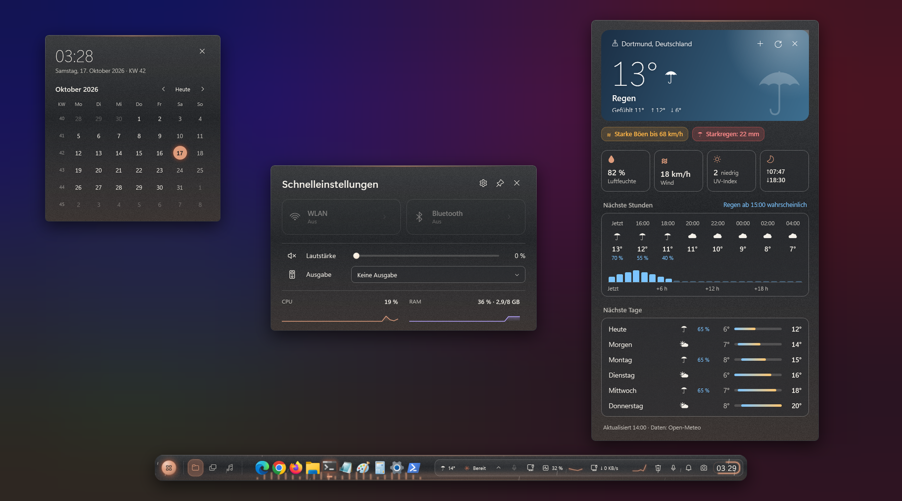
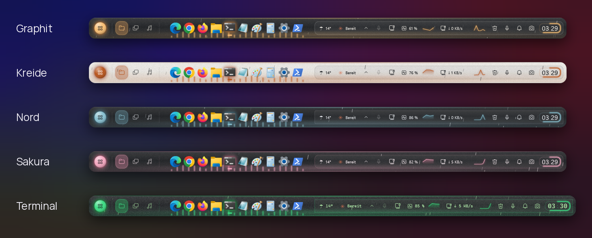
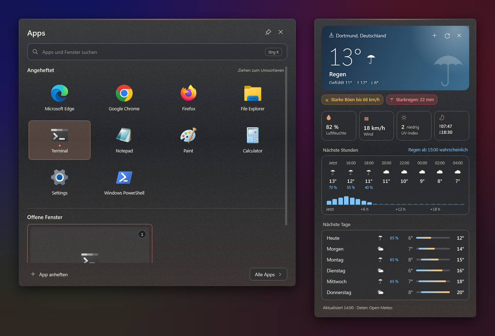
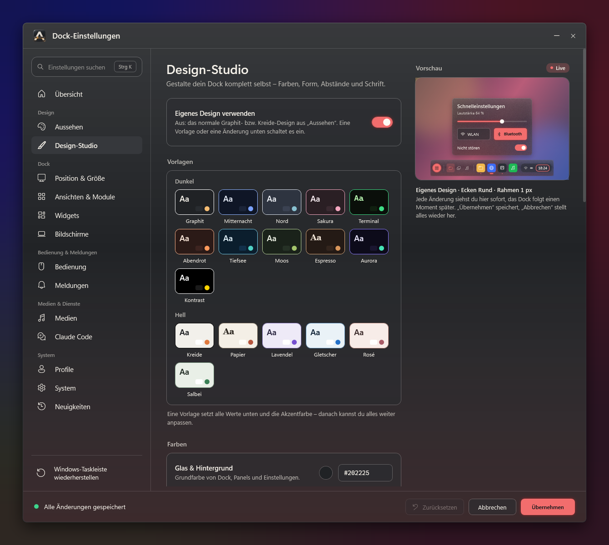
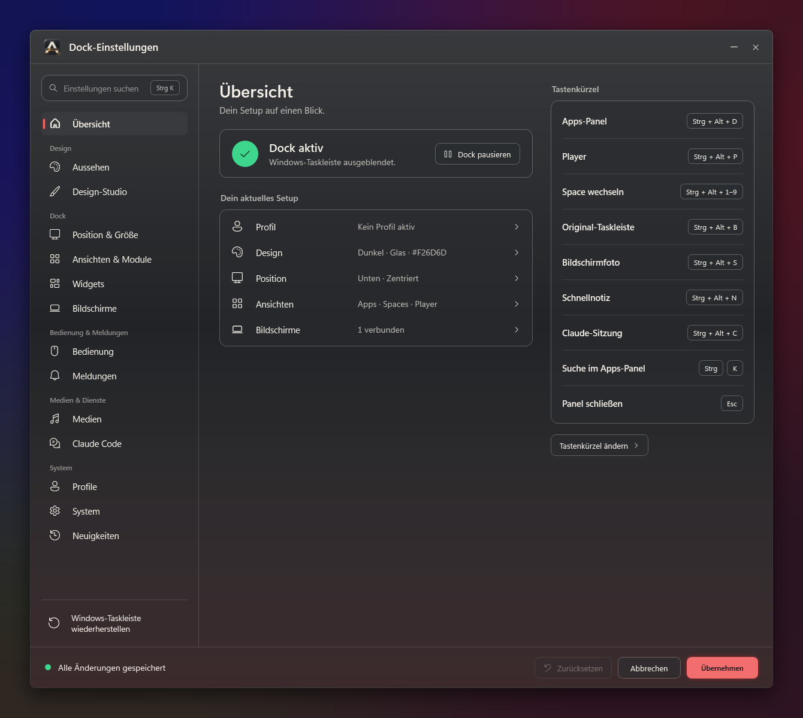
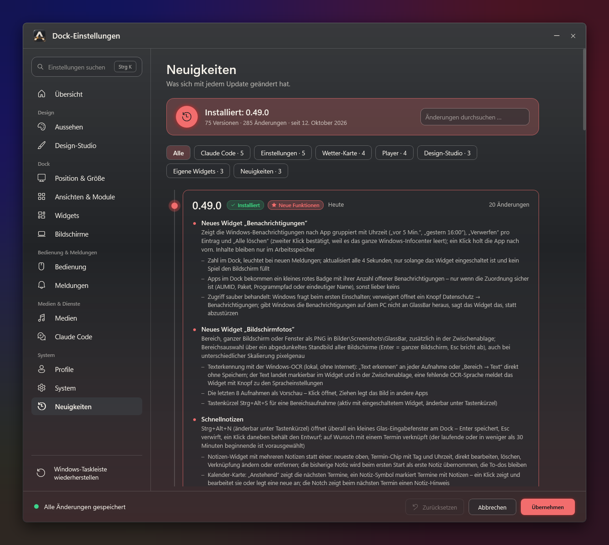
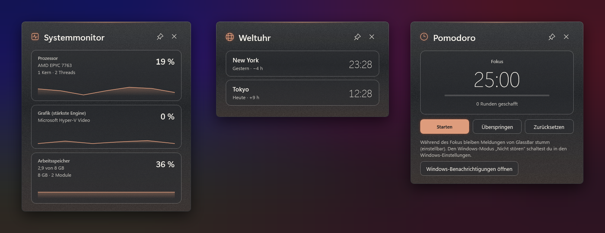
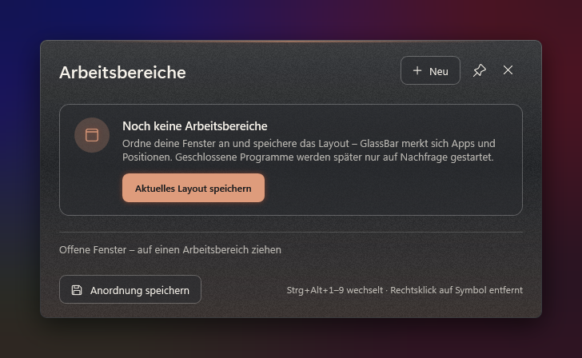
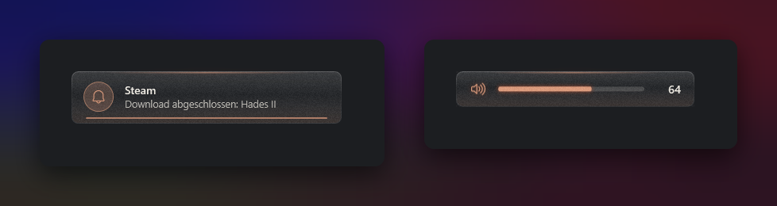

# GlassBar

**Ein schwebendes Glas-Dock als Ersatz für die Windows-11-Taskleiste.**
Apps, Musik, Wetter, Kalender, Widgets und Claude Code in einer Leiste, deren Akzentfarbe sich nach dem laufenden Albumcover richtet.

[English](../README.md) · **Deutsch**

---

## Was ist GlassBar?

GlassBar blendet die Windows-Taskleiste aus und setzt an ihre Stelle ein schwebendes Dock aus echtem Acrylglas. Das Dock reserviert seinen Platz wie die Taskleiste, maximierte Fenster enden also darüber. Es lässt sich an jeden Bildschirmrand und auf jeden Monitor setzen und schaltet per Mausrad zwischen drei Ansichten um: **Apps**, **Arbeitsbereiche** und **Player**.

Ein Klick auf ein Modul öffnet eine eigene Karte darüber: Kalender, Wetter, Schnelleinstellungen, Player oder Claude Code. Alles läuft lokal und ohne Adminrechte. Netzwerkzugriffe gibt es nur für Dienste, die du selbst einschaltest.

## Funktionen

| | |
|---|---|
| 🪟 **Taskleisten-Ersatz** | Laufende und angeheftete Apps mit Leuchten in ihrer Symbolfarbe, Fenster-Vorschau, Infobereich mit allen Tray-Symbolen und Store-Apps per AUMID |
| 🎵 **Player** | Mini-Player im Dock, großes Player-Panel mit Seek-Leiste, Audioausgabe, Spotify-Warteschlange, 4 Lieblingsalben oder -Playlists, Live-Songtexte (LRCLIB, optional) und Audio-Visualizer |
| 🌦️ **Wetter-Karte** | Himmel-Verlauf je nach Wetterlage, fallender Regen oder Schnee, Regen-Kurve für 24 Stunden, Hinweise auf Gewitter, Sturm, Frost und Hitze, 6 Tage mit Temperatur-Balken und mehrere Orte (Open-Meteo, kein API-Key) |
| 🗂️ **Arbeitsbereiche** | Fenster-Layouts speichern und mit Strg+Alt+1–9 wiederherstellen |
| 🤖 **Claude Code** | Status laufender Sitzungen im Dock, Meldung bei fertiger Antwort, Freigaben direkt im Dock beantworten, Tokens und ca. Kosten pro Sitzung, letzte Sitzungen und Schnell-Prompt (Strg+Alt+C) für eine neue Sitzung |
| 🔔 **Benachrichtigungen** | Windows-Benachrichtigungen nach App gruppiert, verwerfen oder alle löschen, Zähler am App-Symbol im Dock |
| 📸 **Bildschirmfotos** | Bereich (Strg+Alt+S), Bildschirm oder Fenster als PNG und in die Zwischenablage, Verlauf mit Vorschau, Texterkennung (Windows-OCR, lokal) |
| 📝 **Schnellnotizen** | Strg+Alt+N öffnet überall ein Eingabefenster, Notizen mit Terminen verknüpfen, Hinweis in Kalender-Karte und Notch, Erinnerung 5 Minuten vorher |
| 🏠 **Smart Home** | Home Assistant: Lichter mit Helligkeit, Schalter, Szenen, Skripte, Rollos, Sensoren und Thermostate; Token DPAPI-verschlüsselt |
| 🧩 **Widgets** | Systemmonitor (mit CPU-, GPU- und RAM-Modell), Netzwerk, Zwischenablage, Pomodoro, Notizen, Downloads, Papierkorb, Mikrofon & Kamera, Geräte-Akku, Weltuhr, GitHub, Dienste und Kurse |
| 🛠️ **Eigene Widgets** | Ordner mit `widget.json` + beliebigem Skript (PowerShell, Python …), URL oder Datei – wird zum Dock-Modul mit Karte, mit eigenen Einstellungsfeldern, vier Vorlagen und Live-Neuladen. [Anleitung](EigeneWidgets.md) |
| 🎨 **Design-Studio** | 17 Vorlagen (dunkel und hell), eigene Farben mit zweiter Akzentfarbe als Verlauf, Akzent-Schimmer, Ecken, Rahmen, Kanten, Schatten, Körnung, Symbolabstand, Dock-Höhe und Schrift; als Datei exportieren und importieren |
| 💊 **Notch-Modus** | Schmale Pille oben, die beim Darüberfahren mit Musik, Wetter, Termin und Claude aufklappt, mit Live-Aktivitäten für Downloads, Timer, Claude Code und CI-Läufe |
| ⚙️ **Einstellungen** | Gruppierte Navigation, Live-Vorschau neben jeder Seite, die jede Änderung an einem Mini-Dock zeigt, Profile mit automatischem Umschalten (Akku, Netzteil, Monitore) |
| 📰 **Neuigkeiten** | Alle Versionen als Zeitleiste mit Suche, Vorschau auf ein bereitliegendes Update und Hinweis auf die Neuerungen nach jedem Update |
| 🛟 **Absturzschutz** | Ein Wächterprozess holt die Taskleiste zurück und startet GlassBar neu |

## Screenshots

### Fünf Looks aus dem Design-Studio

### Apps-Panel und Wetter-Karte

### Design-Studio

### Einstellungen

### Neuigkeiten

### Widgets

### Arbeitsbereiche

### Meldungen und Lautstärke

## Installation

1. Unter **[Releases](https://github.com/ahi3000/GlassBar-Releases/releases/latest)** die Zip für deinen PC laden: `win-x64` (die meisten PCs) oder `win-arm64`.
2. Entpacken, z. B. nach `%LOCALAPPDATA%\Programs\GlassBar`.
3. `GlassBar.exe` starten. Keine Admin-Rechte, kein GitHub-Konto nötig.

Voraussetzungen: Windows 11 und die **[.NET 10 Desktop Runtime](https://dotnet.microsoft.com/download/dotnet/10.0)** (x64 bzw. Arm64).

**Updates:** Einstellungen → System → automatische Update-Prüfung einschalten. GlassBar schaut dann alle 6 Stunden auf dieser Seite nach – ohne Konto – und installiert neue Versionen per Klick; deine Einstellungen in `%AppData%\GlassBar` bleiben erhalten.

**Beenden:** Rechtsklick aufs Dock → „GlassBar beenden“ oder `GlassBar.exe --exit`. Die Taskleiste kommt dann zurück.
**Notfall:** `GlassBar.exe --restore-taskbar` holt die Windows-Taskleiste zurück, auch nach einem Absturz.
**Deinstallieren:** GlassBar beenden und den Programmordner löschen (für die Einstellungen zusätzlich `%AppData%\GlassBar`).

## Bedienung

| Aktion | Wie |
|---|---|
| Ansicht wechseln | Mausrad über der Dock-Mitte oder Tabs anklicken |
| Apps-Panel | Strg+Alt+D, darin Strg+K für die Suche (auch Rechner, Einheiten wie „5 km in mi“ und, wenn eingeschaltet, Währungen) |
| Player | Strg+Alt+P |
| Schnellnotiz | Strg+Alt+N |
| Bildschirmfoto (Bereich) | Strg+Alt+S, mit eingeschaltetem Widget |
| Claude Code: neue Sitzung | Strg+Alt+C, mit eingeschaltetem Claude-Modul |
| Original-Taskleiste kurz zeigen | Strg+Alt+B |
| Arbeitsbereich anwenden | Strg+Alt+1–9 |
| Kalender / Wetter | Klick auf Uhr bzw. Wetter-Modul |
| Schnellaktionen | Rechtsklick aufs Dock |

## Mehr

Eigene Widgets entwickeln: **[EigeneWidgets.md](EigeneWidgets.md)**. Alle Details zu Modulen, Datenablage und Fehlerbehebung stehen im **[Handbuch](Handbuch.md)**, die Versionsgeschichte unter **[Releases](https://github.com/ahi3000/GlassBar-Releases/releases)**.

## Datenschutz

- Keine Telemetrie. Ein Fehlerprotokoll gibt es nur, wenn du es einschaltest.
- Wetter (Open-Meteo), Songtexte (LRCLIB), Spotify, GitHub, Kurse, Währungskurse (EZB) und Smart Home senden erst etwas, wenn du das jeweilige Modul aktivierst.
- Das Spotify-Token und das Home-Assistant-Token werden mit Windows DPAPI verschlüsselt gespeichert.
- Bildschirmfotos, Texterkennung, Benachrichtigungen und Claude-Transkripte bleiben auf dem PC.

---

Downloads eines privaten Projekts · Schrift Manrope unter SIL Open Font License

